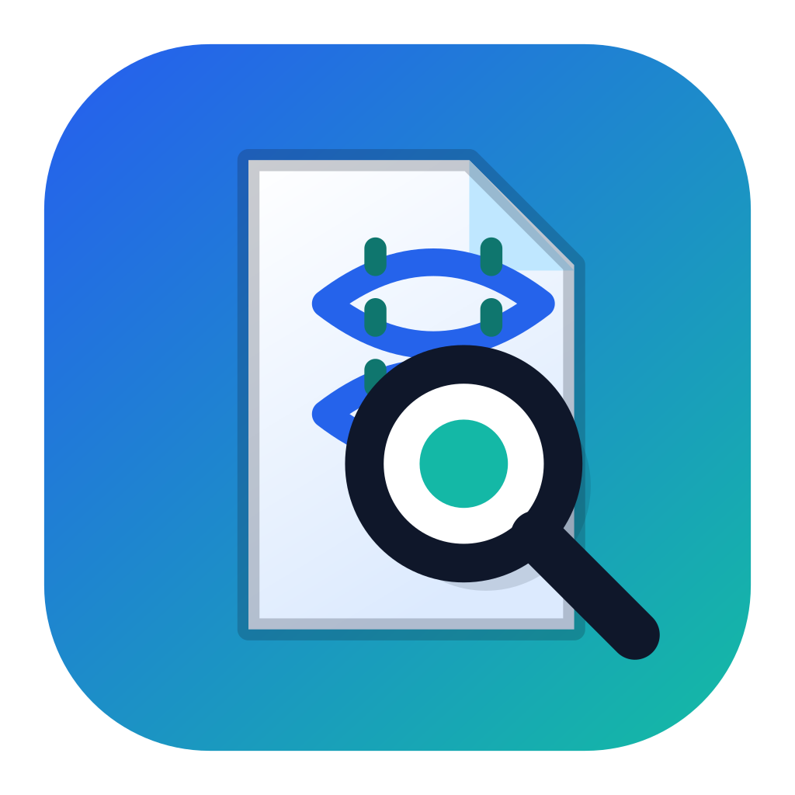

<div align="center">
  
  <h1>ResearchShop</h1>
  <p><strong>A free desktop app that reads open-access PubMed papers and pulls out genes, variants, and the evidence around them.</strong></p>
</div>

You give ResearchShop a topic, a list of papers, or an author name. It keeps the papers whose full text is free to read, then writes a spreadsheet you can review. It runs on your computer. It is a research aid, and every row still needs a person to check it.

<p align="center">
  <a href="https://github.com/michaluppal/Researchshop-Disease2Gene/releases/download/v1.0.2/researchshop-desktop-1.0.2.dmg">
    
  </a>
  &nbsp;
  
</p>

Ignore the green **Code** button on this page. **Source code (zip)** and **Source code (tar.gz)** are the programming files, not the app. `researchshop-v1.0.2-reproducibility.zip` on the [releases page](https://github.com/michaluppal/Researchshop-Disease2Gene/releases/tag/v1.0.2) is a study archive, not an installer.

### Mac

Click the **macOS DMG** button above. It downloads `researchshop-desktop-1.0.2.dmg`.

It is for a Mac with Apple silicon (M1, M2, M3, or M4). It does not run on an older Intel Mac. Apple has not signed this copy, so macOS shows a warning the first time. The app is not damaged.

1. Wait until the `.dmg` file finishes downloading.
2. Open the downloaded file. A window appears with the ResearchShop icon and an Applications folder.
3. Drag **ResearchShop** onto **Applications**.
4. Open **Applications** and double-click **ResearchShop**.
5. If macOS says the app is damaged, click **Cancel**. Do not click **Move to Bin**.
6. Open **Terminal** (press Command + Space, type `Terminal`, press Return).
7. Paste this, then press Return:

```bash
xattr -dr com.apple.quarantine /Applications/ResearchShop.app
open /Applications/ResearchShop.app
```

ResearchShop then opens from the Applications folder like any other app. You do not install Xcode, Node, or Python yourself. The first open finishes the app’s own setup. If it asks you to install Python, install Python 3.10 or newer from [python.org](https://www.python.org/downloads/) and open ResearchShop again.

### Windows

The **Windows EXE WIP** button is only a label. Release v1.0.2 has no `.exe` attached, so that button cannot start a download. The setup file from the test laptop is older than the current open-access fix and is not published here.

## First launch

The first window asks for two things. Both stay on your computer. The Gemini key is sent only from your machine to Google.

1. Read the research-use notice and tick the box. ResearchShop is not a clinical or diagnostic product.
2. Paste a Gemini API key. A free key is enough to try the app. Create one at [aistudio.google.com/app/apikey](https://aistudio.google.com/app/apikey), choose **Validate Key**, then **Next**.
3. Enter an email address. PubMed asks for one so it can identify the program calling it. Then choose **Complete Setup**.

Later changes are under **Settings**: the Gemini key, the email, and the folder where results are saved. If you leave the folder alone, results go to `Documents/ResearchShop`.

## Run a search

1. Choose a starting point: **Full Protocol**, **Author Discovery**, **Paper Analysis**, or **Hybrid**.
2. Enter a topic, paper IDs, or author names. Paper IDs can be PMIDs, DOIs, or PubMed links.
3. Set the columns you want filled in. Each column is a name and a short description of what to extract.
4. Choose **Review & Run**.

The app reads open-access full text from PubMed Central and Europe PMC. Papers it cannot fetch that way are left out. It does not try to get through a paywall.

When the run finishes, open the results folder. The table to read is `final_enriched_results_*.csv` (the same rows are also in `.xlsx` and `.json`). The `*_metadata.csv` file is the extra record of where each row came from. Debug files (`drop_debug_*.json`, `candidate_audit_*.json`) explain papers and candidates that were dropped.

## Before you use a result

Check any row you plan to keep:

- The gene symbol at [genenames.org](https://www.genenames.org).
- A variant, if you have one, at [ClinVar](https://www.ncbi.nlm.nih.gov/clinvar/).
- The source paper. The citation column quotes the supporting sentence; read it in the paper.

A high confidence score means the gene was found in the text and matched a known symbol. It does not mean the biological claim is right. Clinical abbreviations such as CRP, ESR, AST, and ALT can be mistaken for gene names. Findings that live only in a table may have a weak or missing quote. That is a limit of the reader, not a reason to trust the row more.

## For people working on the code

| Need | What to use |
|------|-------------|
| macOS app on a new Apple silicon Mac | the `.dmg` above |
| Windows app for a researcher | not published yet |
| Change the program | the commands below |
| Repeat the tests | the reproducibility commands below |

```bash
git clone https://github.com/michaluppal/Researchshop-Disease2Gene.git
cd Researchshop-Disease2Gene
npm install
npm run dev
```

Development uses Python 3.11 or newer. The app creates `pipeline/.venv` when you run it from source. To create that environment yourself:

```bash
cd pipeline
python3 -m venv .venv
source .venv/bin/activate
pip install -r requirements.txt
```

On Windows, activate with `.venv\Scripts\activate`.

A packaged build carries its own Python. Build one with:

```bash
npm run package:mac:local
npm run package:win -- --x64 --publish never
npm run package:linux
```

`package:mac:local` makes an Apple silicon DMG on this Mac. The Windows command has to run on Windows. Linux packaging is present and has not been release-tested. The build check is [`.github/workflows/build-validation.yml`](.github/workflows/build-validation.yml). Release notes for the paper are in [`docs/planning/SOFTWAREX_RELEASE_CHECKLIST.md`](docs/planning/SOFTWAREX_RELEASE_CHECKLIST.md).

The same pipeline can be run without the window. For a fixed paper list, leave out `--top-n`:

```bash
cd pipeline
source .venv/bin/activate
export GEMINI_API_KEY="..."
export ENTREZ_EMAIL="you@example.org"

python run_pipeline.py \
  --pmids '["19915526","20129251"]' \
  --columns '{"Key Finding": "The main genetic finding"}' \
  --output-dir /tmp/results
```

For a topic search, `--top-n` is how many open-access papers to keep after search and ranking:

```bash
python run_pipeline.py \
  --query 'BRCA1 breast cancer GWAS' \
  --columns '{"Key Finding": "The main genetic finding"}' \
  --top-n 5 \
  --output-dir /tmp/results
```

Checks for a fresh copy of the project:

```bash
npm install
npm run typecheck
npm run test
cd pipeline
python3 -m venv .venv
source .venv/bin/activate
pip install -r requirements.txt
python -m pytest tests/ -v --tb=short
```

How the steps fit together is written in [`docs/pipeline/pipeline-contract.md`](docs/pipeline/pipeline-contract.md).

## How to cite

> ResearchShop v1.0.2. GitHub: <https://github.com/michaluppal/Researchshop-Disease2Gene>.

## License

Apache License 2.0. See [LICENSE](LICENSE).

The ResearchShop name and logo identify the project. They do not mean the authors endorse another product or paper.
